# Pasos realizados

## Creación de reglas en la AWS

- Se añaden las reglas para permitir la conexión remota por SSH - **Puerto 22**
- Se añade la regla para la conexión HTTP - **Puerto 80**
- Se añade la regla para la conexión HTTPS - **Puerto 443**

Debido a que este grupo de reglas son para los equipos de clase se especifica que solo nuestra IP tiene acceso.

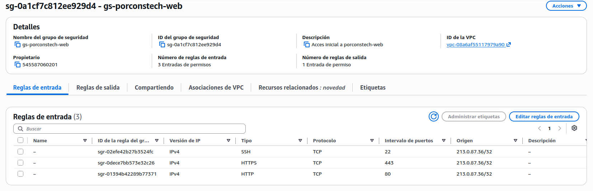


Debido a que nuestra IP puede cambiar es posible que debamos actualizar esto en el futuro


## Claves para la conexión remota

Desde el panel del laboratorio con el CLI de AWS podemos descargar el archivo .pem, deberemos darle permisos de ejecución a ese archivo.
También sera necesario entrar al archivo de credentials y actualizar el conjunto de claves.

## IP Elástica

Crear una IP elástica es muy sencillo, desde la instancia de AWS buscamos la configuración de redes que debería estar en el menu de la izquierda, en la parte inferior.

Desde ahí es tan fácil como asignar una IP elástica y nuestra maquina pasara a tener la misma IP.

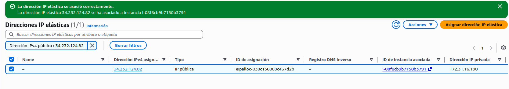

Esto gasta muchos créditos de AWS Por lo que para el resto de las practicas lo deshabilitaremos para ahorrar créditos. Para un entorno de producción si seria necesario usar IP elástica.


## Instalación pila LAMP

La pila LAMP no tiene misterio, no deja de ser **Linux**, el cual ya lo tenemos instalado, **Apache**, **MySQL** y **Php**, los cuales instalaremos a continuación

Debido a que estamos usando **Ubuntu** para esta practica todos los paquetes están en los repositorios por lo que solo tenemos que utilizar

```
sudo apt-get install
```
con los paquetes de dichas plataformas y se instalara automáticamente. Si añadimos -y al comando se instalaran sin confirmación, es posible que tengamos que configurar algo mas adelante en alguno de los paquetes durante la instalación.

### Apache2

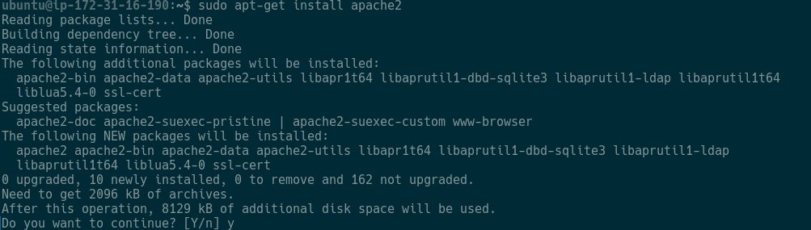

Podemos ver que no ha dado ningún error, la pagina debería ser visible con nuestra IP elástica en el navegador.

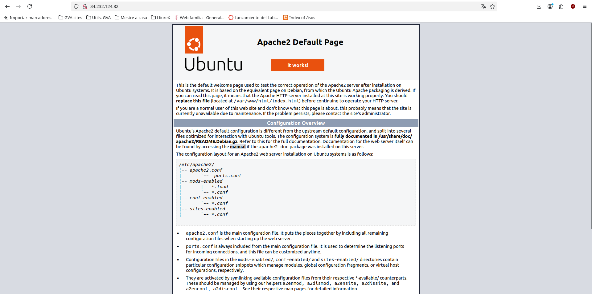

En las siguientes capturas la IP sera una diferente ya que la IP elástica estará deshabilitada para ahorrar creditos.


### MySQL

Instalación sin errores de **MySQL**

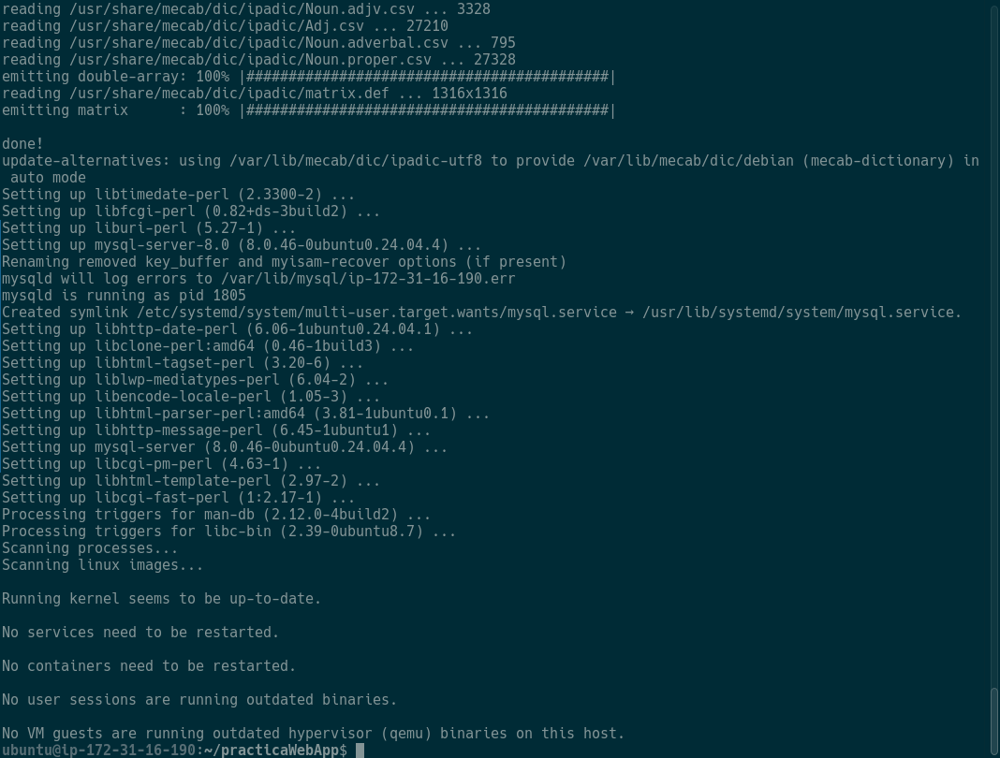

No hemos creado ningún usuario root ni especificado contraseña por lo que esto tendremos que hacerlo mas adelante.


### Php

Instalación de **Php** sin errores.

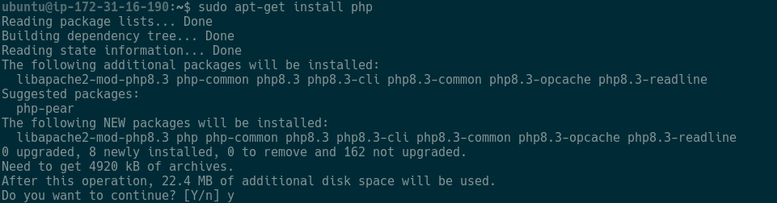

Durante la instalación nos debería de solicitar esta opcion

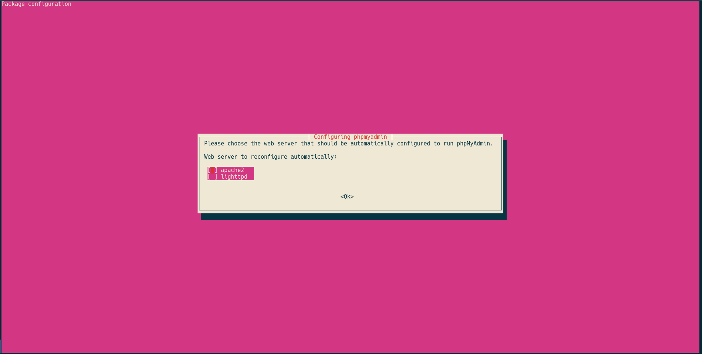

Elegimos Apache dos, que es nuestro servidor web

Paginas creadas con la instalación de php

PhpMyAdmin
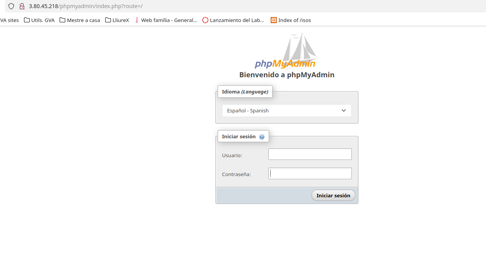


## Extras

### Adminer

Instalación de adminer

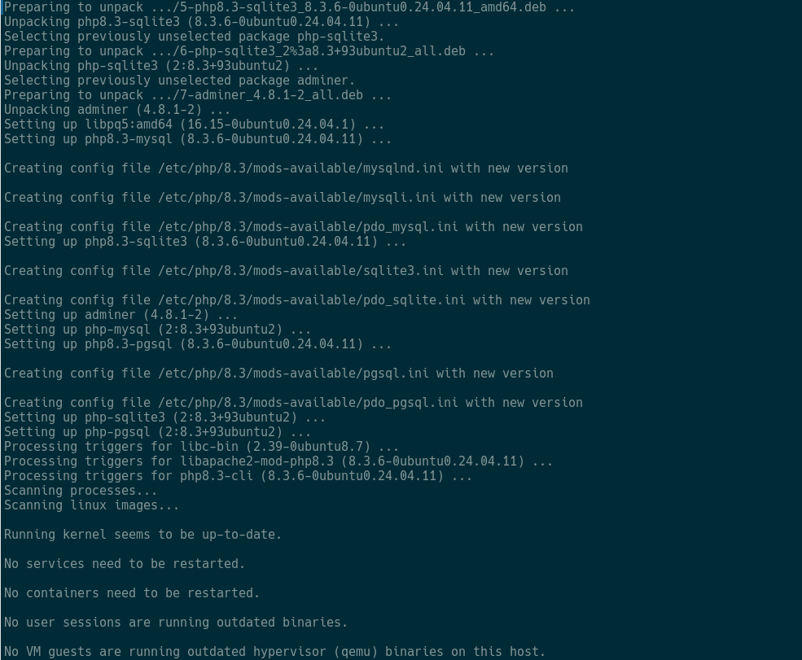

Aplicamos configuración de adminer

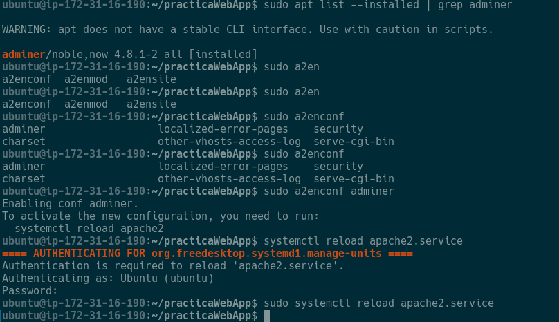

Deberíamos tener esta web de aminer

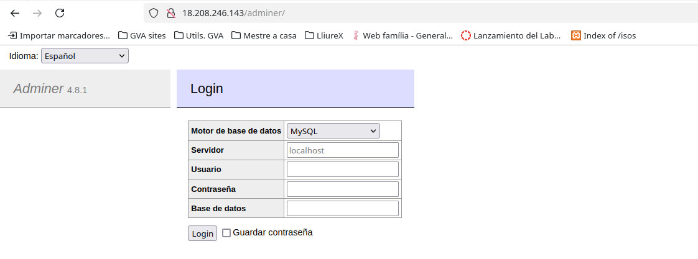

### GoAccess

Utilizaremos GoAccess para crear unos registros que podremos acceder desde la web.

Instalación 

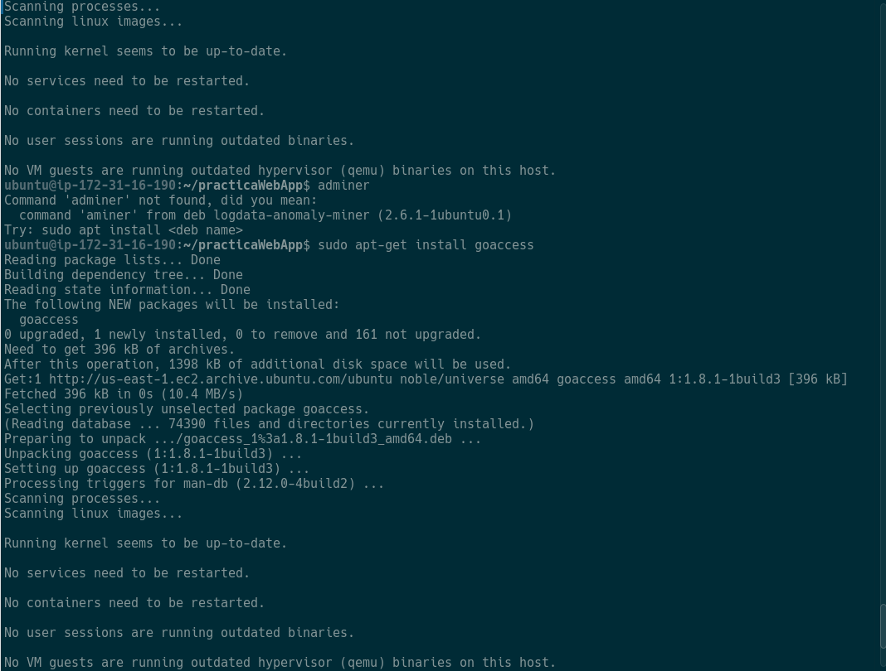


Gracias
---
