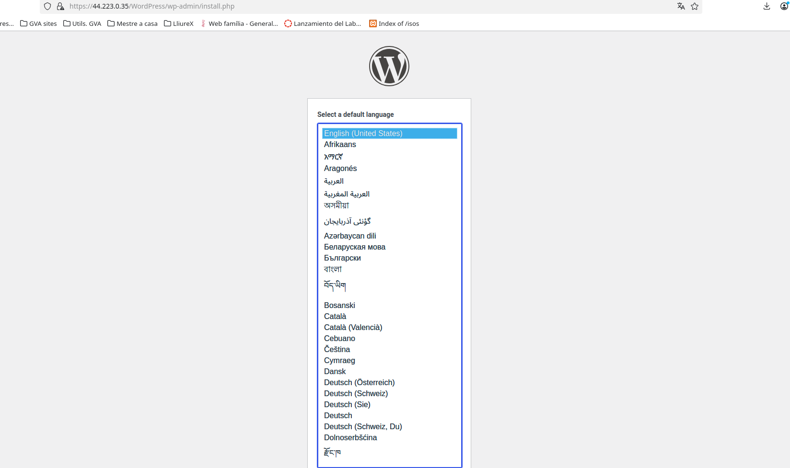
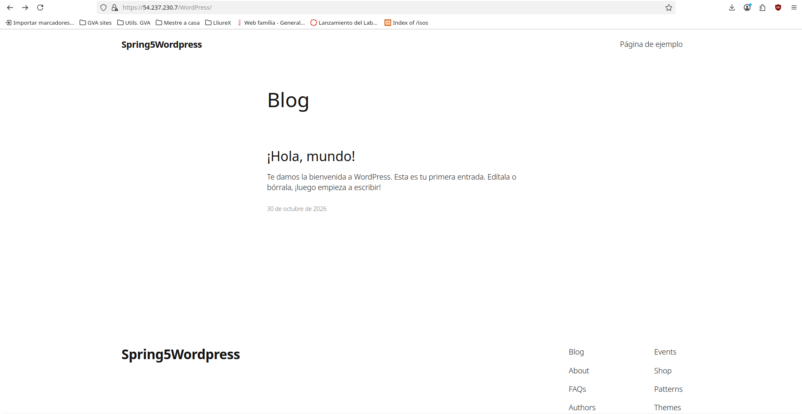
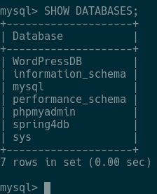
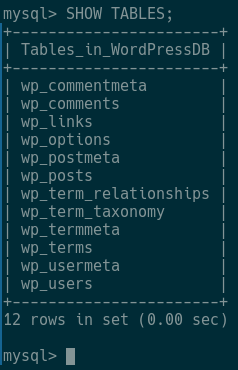
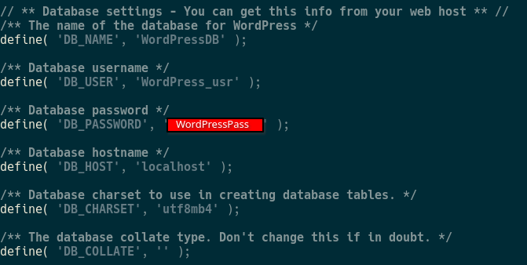
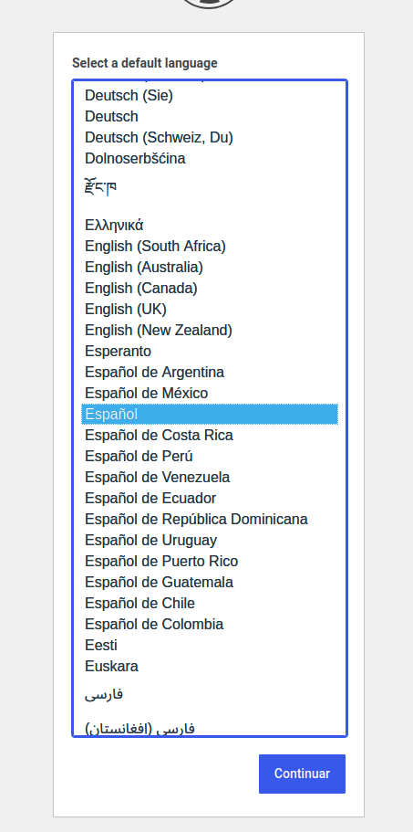
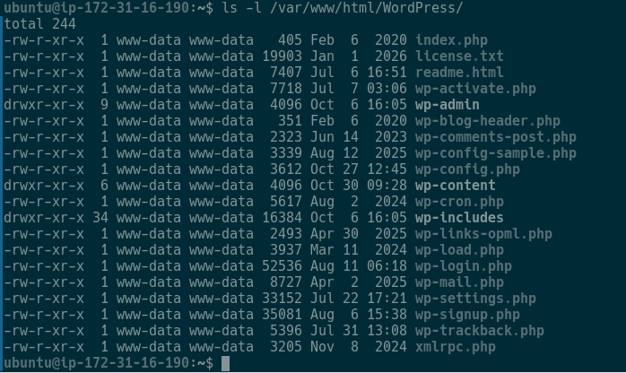
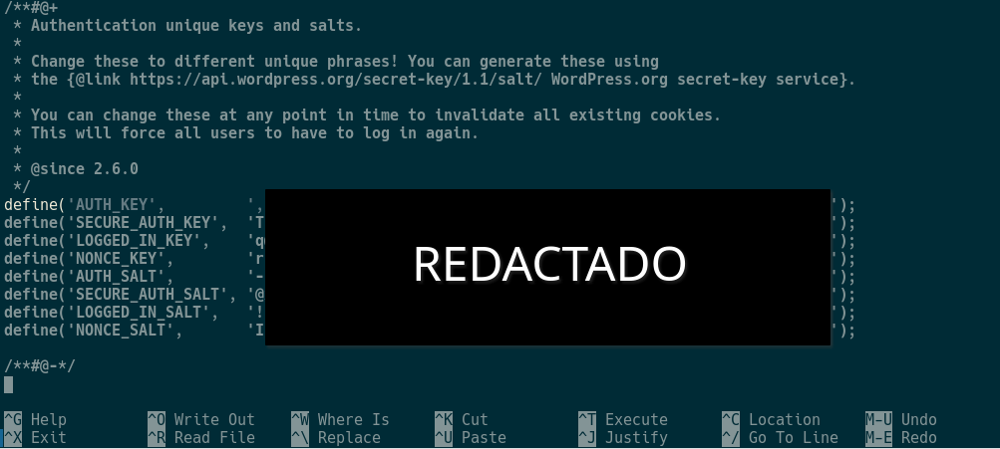
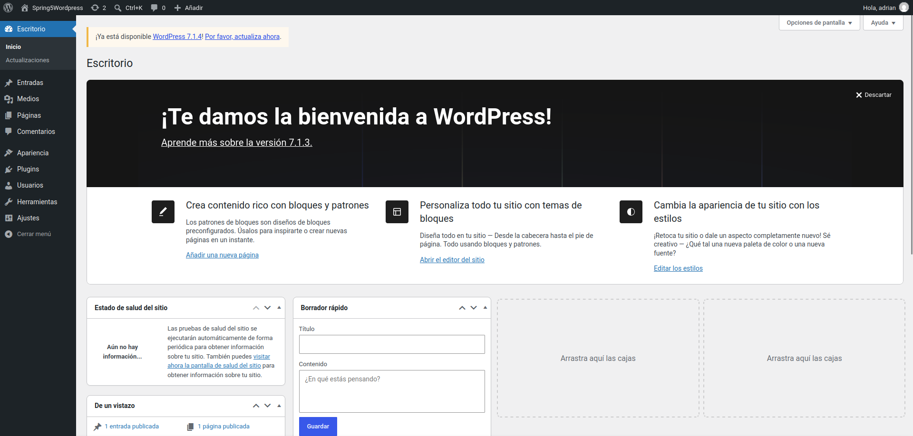

# Pasos realizados

## E1

## E2

Pagina de la configuracion inicial de wordpress

Pagina principal de wordpress

Necesitamos:

- Una base de datos
- Servidor web
- Php
- Wordpress instalado

## E3

Base de datos utilizada

Tablas en la base datos

Wordpress necesita una base datos para almacenar la informacion interna como usuarios, configuracion, etc

## E4

Indicamos la configuracion de la DB

| Parametro | Valor | funcion |
|---|---|
| `DB_NAME` | WordPressDB | Nombre de la base de datos |
| `DB_USER` | WordPress_usr | Usuario de la base de datos |
| `DB_HOST` | localhost | Ubicacion de la base de datos |
| `DB_PASSWORD` | *[REDACTADO]* | Contraseña de la base de datos |

## E5

Seleccion de idioma

Configuracion de Wordpress

## E6

Permisos

Claves de seguridad

En serio hay que explicar porque no tienes que publicar contraseñas u claves en internet?

## E7

Pagina publica

Pagina wp admin

