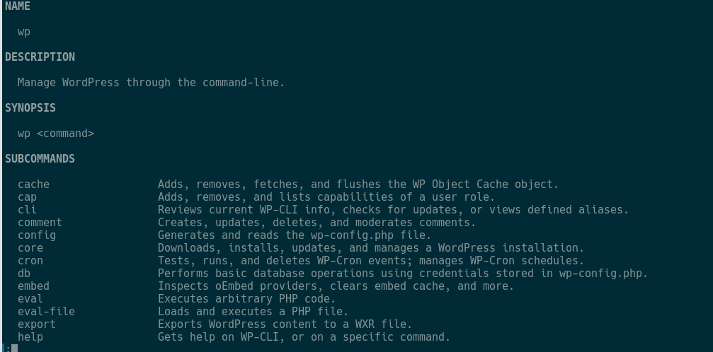
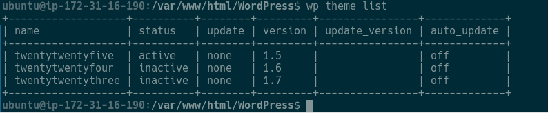
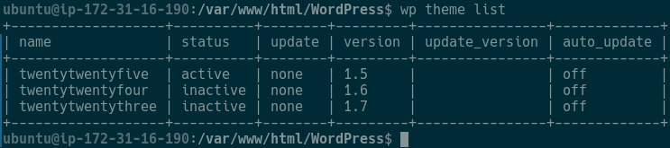
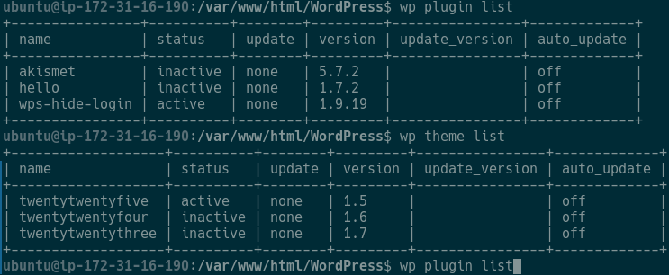
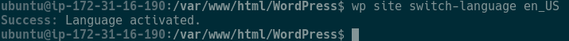
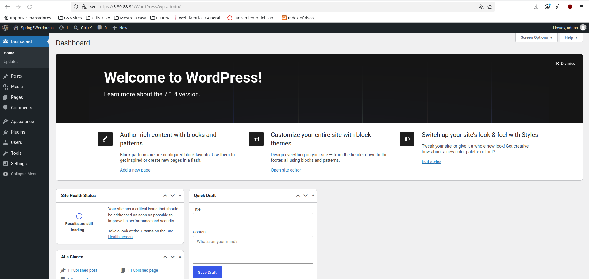

# Pasos realizados

## E1

Comando del WP

**¿Que es el WP-CLI y que ventaja tiene respecto a wp-admin?**
El WP-CLI es la linea de comandos de Worpdress, permite realizar tareas como con el Wp-admin solo que al ser comandos puede ser mas rapido y ademas ser automatizado.

## E2

Lista de plugins

**Que operacion has realizado sobe el plugin y como has comprobado el cambio?**
Hemos realizado varias operaciones con los plugins, como instalarlo y desinstalarlo

## E3

Listado de temas

**¿Que operacion has realizado sobre el plugin y como has comprobado que se he aplicado?**
He activado el plugin y luego desactivado, aparece un campo de estado que indica su estado actual.

## E4

Lista de plugins y de temas

**¿Porque es importante actualizar el core, plugins y temas de Worpdress?**
Para obtener nuevas opciones y evitar problemas de seguridad

## E5

Configuracion de idioma

**¿Que configuracion has modificado y como has comprobado que funciona?**
He configurado el idioma, al entrar estaba en ingles en vez de en Español.

## E6

Panel WP admin

**¿Que comprobaciones has realizado para asegurarte de que Worpdress sigue funcionando correctamente?**
He revisado que se podia seguir entrando y que las webs que estaban creadas seguian estando como estaban.

